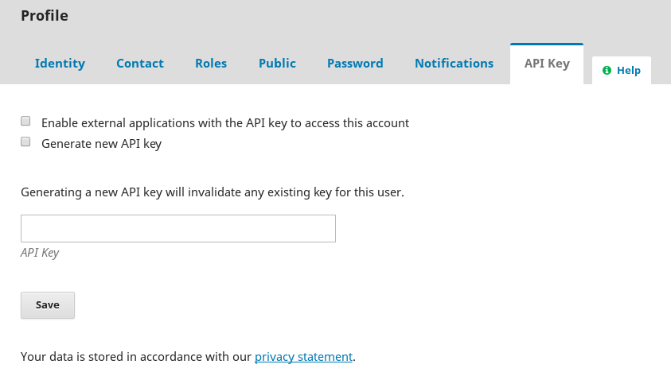

# Providing an API key

Please follow these instructions to provide an API key when requested by the Coalition Publica team. This additional configuration is required to allow Érudit to access content in the following cases: 

* the journal is using OJS to publish content that requires a subscription, 
* the journal is using OJS for editorial workflow but not for online publishing,
* the journal has opted for full text XML production and Érudit requires access to production ready files for harvesting

You will need to be running **OJS [Long-Term Support](https://pkp.sfu.ca/software/ojs/download/) version or newer**.

## Site Administrator Steps

The following steps can be performed within OJS by users with the Site Administrator or the Journal Manager role **after** a System Administrator has followed the System Administrator Steps of this document, notably *Step 3. Ensure that you have entered an API key secret*.

### Step 1. Create a Subscription Manager

In this step, you will create a new user with a Subscription Manager role. If you already have a Subscription Manager, you may skip this step and use that account instead. However, for security reasons, it is not recommended to use an account with any roles aside from Subscription Manager (it’s better to have a single role for this account, the Subscription Manager role). Later you will grant Érudit permission to act as this user when collecting content from your installation by providing the API key secret associated with this user account.

As a Journal Manager or Site Administrator, go to Users & Roles > Users. 

Click the “Add a User” button to create a new user account.

Fill out the form and click “Save.” Although we recommend using real information when creating users for your journal, this is not required. The important thing is to fill out the required fields and make a note of the username and password you used.

Find the user you just created in the user list and click the blue arrow next to their name. Click “Edit User” from the options that appear.

Check “Subscription Manager” in the User Roles dropdown menu, and be sure to save your changes.

This completes the process of creating a user. Remember the username and password you used when creating the account.

### Step 2. Generate an API Key

Log out of your OJS installation, and log in again using the credentials for the Subscription Manager account you created in Step 1.

Navigate to your user Profile (typically available in the top-right corner).

Open the “API Key” tab:

There may already be content in the “API Key” box. If so, ignore it.

Use this form to perform the following:

1. Check the “Enable external applications with the API key to access this account” checkbox.
2. Check the “Generate new API key” checkbox.
3. Press the “Save” button.
4. Uncheck the “Generate new API key” checkbox.
5. Press the “Save” button.

With this, the “API Key” box should contain a long string of numbers and letters. This key will allow Érudit to perform actions as this newly-created user and download embargoed or unpublished content. Copy this to your clipboard, and provide it via email to your Coalition Publica contact. **Please be sure to uncheck the “Generate new API key” checkbox to prevent the key you share with Coalition Publica from inadvertently being overwritten.**
