# Configuration initiale

Érudit utilise le format XML standardisé [JATS](https://jats.nlm.nih.gov/) pour récupérer les articles de votre instance OJS. Vous devrez configurer OJS afin qu’il génère automatiquement des fichiers JATS simples **pour chaque revue** qui sera diffusé sur Érudit. 

Vous devez disposer des droits d'administrateur du site pour activer des plugiciels et pour vous assurer que les paramètres de langue et de distribution sont correctement définis. 

Vous devez disposer des droits d'administration du système pour configurer l'extraction de texte et les éléments du référentiel OAI. 

Les étapes nécessaires à l'installation et à la configuration d'OJS pour chaque niveau d'autorisation sont décrites dans les sections suivantes.


## Étapes de l’administrateur du site {#site-admin}

Pour chaque revue à inclure sur Érudit, vous devez activer deux plugiciels. Connectez-vous à votre instance OJS avec les paramètres de connexion de votre compte Administrateur de site.


### Étape 1. Activer  le « Plugiciel de modèle JATS » et le plugiciel « Format de métadonnées JATS »

 Allez à Paramètres > Site Web > Plugiciels >  Plugiciels installés 

Dans la rubrique *Plugiciels génériques* cherchez « Plugiciel de modèle JATS »

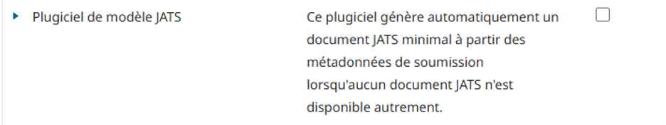  

Cochez la case à droite pour activer le plugiciel. Une notification que le plugiciel a été activé devrait s’afficher :
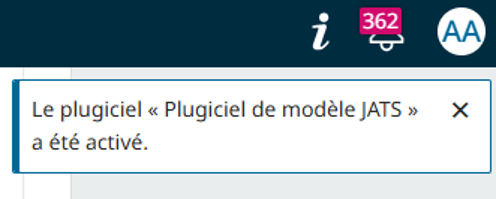  


Cherchez ensuite sous la rubrique *Plugiciels du format de métadonnées OAI* dans la liste des plugiciels installés pour le plugiciel  « Format de métadonnées JATS » 
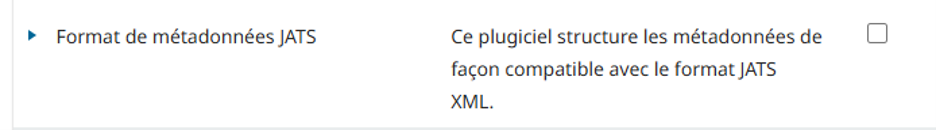  

Cochez aussi la case à droite pour l’activer. Une notification que le plugiciel a été activé devrait s’afficher :

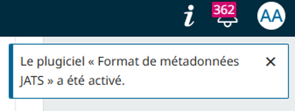
  

**Si la revue publie des épreuves XML de ses articles**, vous devrez modifier les paramètres du plugiciel format de métadonnées JATS. Les revues qui ne publient **pas** d’épreuves XML peuvent ignorer cette étape, à moins qu'elles n'aient reçu des instructions contraires de la part de Coalition Publica à la suite d'un test de moissonnage.

Cliquez sur la flèche bleue à côté de  « Format de métadonnées JATS » afin d’accéder aux paramètres du plugin:

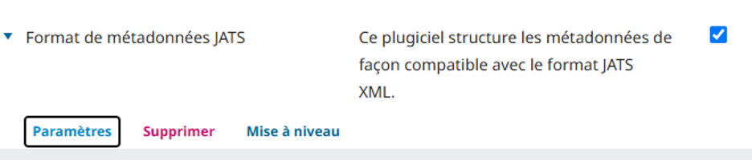  

Cochez ensuite la case à côté de « Ignorer les documents XML JATS téléchargés », puis cliquez sur OK. 

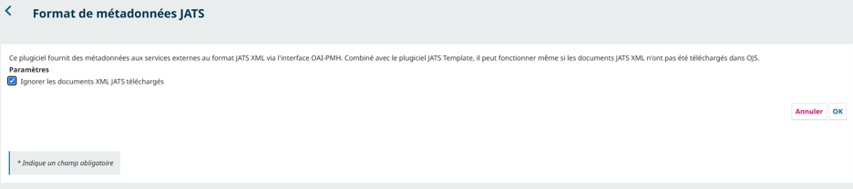  


### Une note sur la mise à jour des plugiciels

Les plugiciels utilisés pour moissonner les métadonnées d’une revue sont parfois mis à jour pour corriger des bogues ou améliorer leurs fonctionnalités. Il se peut que Coalition Publica vous demande de mettre à jour les plugiciels, ou vous pouvez choisir de le faire dans le cadre de votre maintenance régulière.

Après toute mise à jour de votre OJS, assurez-vous que tous vos plugiciels sont mis à jour avec la dernière version adaptée à votre version d’OJS. Pour mettre à jour un plugiciel: 

Allez dans Paramètres > Site Web > Plugiciels >  Galerie de plugiciels 

Notez que les noms des plugiciels dans la galerie ne se traduisent pas. Les plugiciels requises par Coalition Publica sont nommées « OAI JATS Plugin » et « JATS Template Plugin ». Recherchez celles-ci dans la liste de plugiciels.

Dans la colonne « Statut », la notification « Mise à jour disponible » s'affiche lorsqu'une mise à jour compatible avec votre version d'OJS sera disponible. 

Cliquez sur le nom du plugiciel (lien hypertexte) pour ouvrir la fenêtre de renseignements. Cliquez sur le bouton « Mise à niveau », puis confirmez que vous souhaitez mettre à jour le plugiciel.

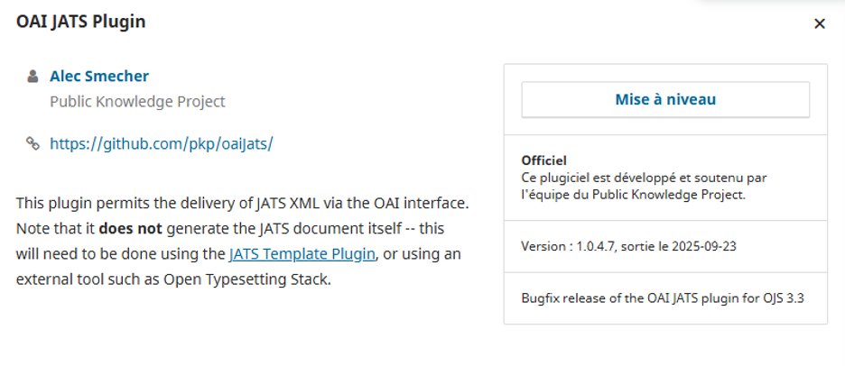  

Vous devriez voir une notification confirmant la dernière version disponible du plugin à été mis à jour .
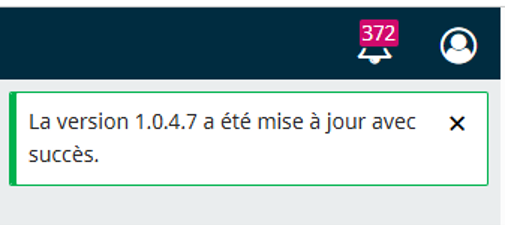 
 
Bien qu’il soit possible de mettre à jour les plugiciels dans OJS en téléchargeant la dernière version à partir de Github, il est possible que les versions plus récentes ne soient pas compatibles avec votre version particulière d’OJS, donc **s’il vous plaît, mettez toujours à jour les plugiciels à partir de la Galerie de plugiciels, sauf indication contraire.**


### Étape 2. Réviser les paramètres régionales de revue

Un « paramètre régional » est requis et doit être installé pour chaque langue dans laquelle la revue publie, même s'il ne le fait que rarement.

Connecté en tant qu'administrateur du site, allez à Paramètres > Site web > Configuration > Langue pour vérifier que toutes les langues dans lesquelles la revue publie sont répertoriées.

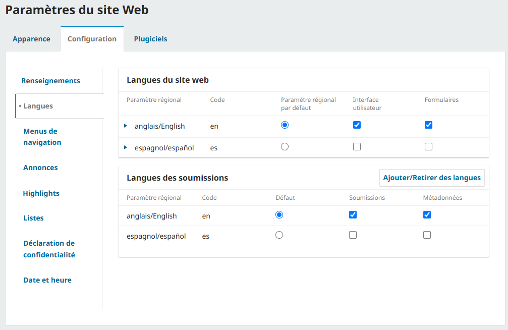

Si une langue n'est pas répertoriée, vous devez installer cette langue. 

Allez à Administration > Paramètres du site > Réglage du site > Langues. 

Cliquez sur « Installer le paramètre régional » :

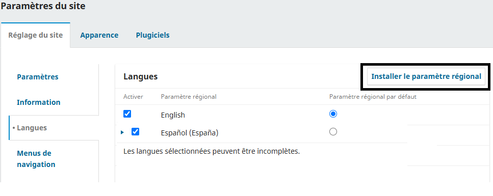

Cochez les paramètres régionaux que vous souhaitez installer et cliquez sur Enregistrer.

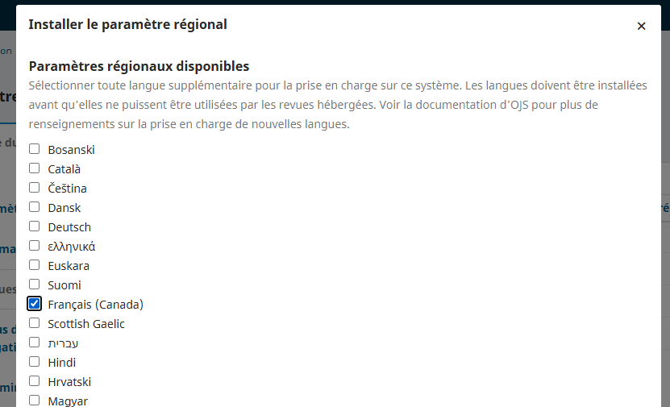

La langue devrait maintenant apparaître dans la liste des langues disponibles.

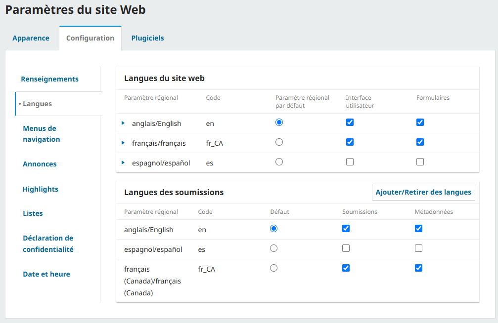

Notez que si la revue publie en français, la paramètre régional Français (Canada) est recommandée pour les revues sur Érudit.


### Étape 3. Vérifier les paramètres de distribution

Sous Paramètres > Distribution > Accès, il existe un ensemble de paramètres :

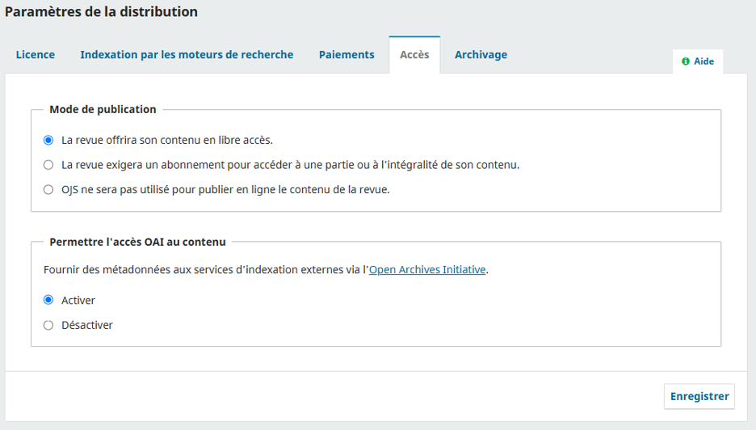 

Assurez-vous d’avoir coché « Activer » dans la section « Permettre l'accès OAI au contenu » . Enregistrez les paramètres.

### Note concernant les clés API

Un paramétrage supplémentaire est nécessaire pour permettre à Coalition Publica de moissonner le contenu des articles et numéros diffusés sur OJS dans les cas suivants : 
* la revue utilise OJS pour publier du contenu requérant un abonnement ;
* la revue utilise OJS pour la gestion éditoriale sans publier ;
* la revue a choisi la production XML du texte intégral et Érudit a besoin d'accéder aux fichiers prêts pour la production pour moissonnage.

Si Coalition Publica vous demande une clé API, l'administrateur du site ou quelqu’un ayant le rôle Directeur de la revue devra suivre les étapes décrites dans la section *Fournir une clé API* du présent document pour terminer la configuration de la revue. 

Toutefois, les étapes décrites dans la section *Fournir une clé API* doivent être réalisées **après** qu'un administrateur système a effectué les étapes 1, 2 et 3 de la section Étapes de l'administrateur système ci-dessous.


## Étapes de l'administrateur système {#sys-admin}

Les étapes suivantes nécessite un accès *backend* à OJS par un administrateur système. Ces étapes doivent être suivies **après avoir effectué les étapes décrites dans la section relative à l'administrateur du site.** Il se peut que vous deviez contacter votre fournisseur d'hébergement ou votre responsable technique pour effectuer les étapes suivantes.


### Étape 1. Activer l’indexation des PDF

Cette étape peut requérir l'aide de votre administrateur système puisqu'elle requiert l’accès à un fichier sur le serveur où votre instance OJS est installée.

* Assurez-vous que votre instance OJS connaisse l’emplacement de vos outils d’extraction de texte sur vos serveurs : vérifiez la section `[search]` de votre fichier `config.inc.php` pour vous assurer que les emplacements serveur de ces outils sont spécifiés.
* Si vous avez dû modifier votre fichier `config.inc.php` pour activer l’indexation PDF, vous devrez également reconstruire votre index de recherche. Vous pouvez le faire en exécutant la commande suivante sur votre serveur, dans la racine Web OJS:

```
php tools/rebuildSearchIndex.php
```

REMARQUE: cette étape n’est requise que si vous avez récemment activé l’indexation PDF.

* Vous pouvez vérifier que l’index a été correctement reconstruit en recherchant du texte qui n’apparaît que dans un PDF (c’est-à-dire pas dans d’autres métadonnées de soumission stockées par OJS, telles que des champs de titre ou de résumé).

En plus de configurer votre OJS pour Coalition Publica, cela permettra à OJS d’indexer les documents PDF pour son propre moteur de recherche.


## Étape 2. Configurez l’identifiant d’espace de nom de votre OAI

Le dépôt OAI de chaque instance OJS doit être configuré afin d’avoir un identifiant d’espace de nom (un *namespace-identifier* selon la syntaxe OAI-PMH) unique. L'identifiant est configuré lors de l'installation, et se trouve par la suite dans le fichier de configuration config.inc.php.

### Choisir un identifiant unique pour le dépôt OAI
L’identifiant d’espace de nom de votre dépôt OAI doit être unique au sein de l’instance OJS sur laquelle votre revue est hébergée. Un choix logique consiste à utiliser la partie de premier niveau de l’URL de l’instance OJS. Par exemple, si l’URL est « https://revues.bibliotheque.exemple.com », vous pouvez utiliser « revues.bibliotheque.exemple.com » comme identifiant de nommage. 
L’identifiant d’espace de nom que vous utilisez doit respecter la syntaxe [URI (Uniform Resource Identifiers)](https://www.ietf.org/rfc/rfc2396.txt?number=2396). En particulier, tous les caractères réservés de la section 2.2 ne peuvent pas être utilisés : `;`, `/`, `?`, `:`, `@`, `&`, `=`, `+`, `$`, ou `,`.

### Modifier l'identifiant d’espace de nom de votre dépôt OAI

Cet identifiant peut être configuré dans le fichier config.inc.php dans votre répertoire d'installation OJS et peut être modifié directement. Il se trouve dans la section [oai] du fichier de configuration et doit être ajouté après repository_id = . Évitez de modifier inutilement l'identifiant de votre dépôt, mais si vous devez le modifier, veuillez envoyer un courriel à info@coalition-publi.ca avant de le faire surout s'il y a déjà une revue sur votre instance qui participe à Coalition Publica.

### Étape 3. S’assurer d’avoir saisi un API key secret

**Cette étape n’est que requise si Coalition Publica vous demande une clé API.**

Dans votre fichier de configuration OJS (`config.inc.php` dans le répertoire d’installation de votre OJS) vous trouverez une directive appelée « `api_key_secret` ». Par défaut, ce paramètre est vide. Si c’est le cas, modifiez-le pour qu’il contienne une séquence de 32 caractères ou plus (n’importe quelle lettres et symboles). Votre instance OJS en sera plus sécurisée lors de l’utilisation des *Clés API*.

Vous n’aurez pas à mémoriser la valeur de ce paramètre, mais si vous le perdez, tous ceux utilisant les *Clés API* devront en obtenir une nouvelle.

Un coup le paramètre renseigné, sauvegardez le fichier.
