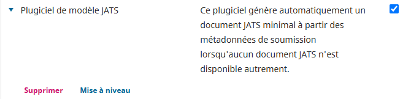
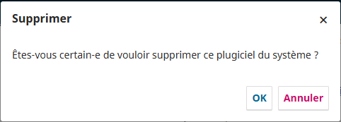
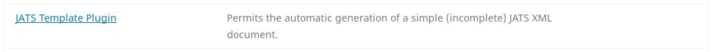
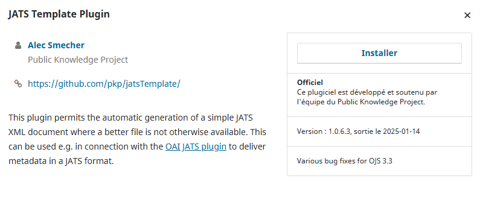
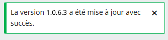
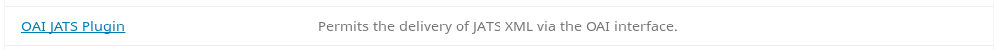
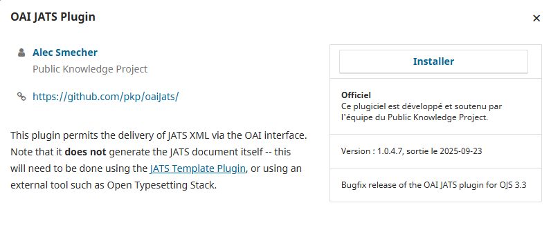

# Aide au dépannage

Si les tests initiaux de moissonnage se soldent par un échec ou que le moissonnage plein texte échoue alors qu'il a déjà fonctionné auparavant, veuillez suivre les instructions de l'équipe de Coalition Publica ci-dessous. Vous aurez besoin des droits d'administration du site et d'adminisatration système.

## Désinstaller et réinstaller les plugiciels puis recréer l'index de recherche.

## Étapes de l’administrateur du site

### Étape 1. Supprimer les plugiciels *Plugiciel de modèle JATS* et *Format de métadonnées JATS*.

Connectez-vous à votre instance OJS avec votre compte d'administration du site.

Allez dans Paramètres > Site Web > Plugiciels

Cliquez sur « Plugiciels installés » pour voir la liste de tous les plugiciels déjà installés.

Dans la section *Plugiciels génériques*, repérez le « Plugiciel de modèle JATS » puis cliquez sur la flèche bleu à gauche.

Cliquez sur le bouton « Supprimer ».



Confirmez que vous souhaitez supprimer ce plugiciel du système.



Dans la section *Plugiciels du format de métadonnées OAI*, repérez le plugiciel « Format de métadonnées JATS » puis cliquez sur la flèche bleu à gauche.

Cliquez sur le bouton *Supprimer* puis confirmez que vous souhaitez supprimer ce plugiciel du système.

### Étape 2. Réinstaller et activer les plugiciels
Notez que les noms des plugiciels dans la galerie ne se traduisent pas. Les plugiciels requises par Coalition Publica sont nommées « JATS Template Plugin » et « OAI JATS Plugin » 

### Étape 3. Installer la dernière version du « JATS Template Plugin »

Allez dans Paramètres > Site Web >  Galerie de plugiciels

Une liste des plugiciels disponibles pour installation sera affichée. Recherchez « JATS Template Plugin »:



Cliquez sur le nom du plugiciel en hyperlien pour afficher de plus amples renseignements :



Cliquez sur le bouton « Installer » et confirmez que vous souhaitez bien installer le plugiciel.

Une notification confirmant l’installation devrait s’afficher :




### Étape 4. Installer la dernière version du « OAI JATS Plugin »

Recherchez « OAI JATS Plugin » dans la Galerie de plugiciels:



Cliquez sur le nom du plugiciel en hyperlien pour afficher de plus amples renseignements :



Cliquez sur le bouton « Installer » afin d’installer le plugiciel et puis confirmez que vous souhaitez l’installer.

Une notification confirmant l’installation devrait s’afficher :


### Étape 5.  Activer encore une fois les plugiciels
Suivez les étapes 1 à 3 du guide de configuration initiale{initial-setup#site-admin} pour activer les plugiciels « Plugiciel de modèle JATS » et  «Format de métadonnées JATS ». Notez que les deux plugiciels sont traduits ce dernier s'agit du « OAI JATS Plugin », renommé par le système pour s'aligner sur la convention de nommage la section *Plugiciels de format de métadonnées OAI*.

## Étapes de l'administrateur système {#sys-admin}

### Dépannage de l'outil d'analyse de texte intégral PDF

Vérifiez que les outils d'analyse de PDF sont installés et configurés correctement.

Dans le répertoire OJS, vérifiez le fichier `config.inc.php` à la section `[search]`. Repérez la zone débutant par `; PDF`. Elle devrait ressembler à ceci :

```
index[application/pdf] = "/usr/bin/pdftotext -enc UTF-8 -nopgbrk %s - | /usr/bin/tr '[:cntrl:]' ' '"
```

Assurez-vous que :
* Un des outils est activé / décommenté dans le fichier `config.inc.php`.
* Une des lignes sous `; PDF` est décommentée (non préfixée d'un point-virgule (`;`)).

Dans l'exemple ci-dessus, `/usr/bin/pdftotext` est l'outil utilisé. Vous devez valider que cet outil est installé correctement sur le serveur et que le chemin d'accès est valide pour le système d'exploitation (OS) et la version utilisés.

### Pour recréer l'index de recherche

* Assurez-vous que votre instance OJS connaît les outils d'extraction de texte de votre serveur : dans le fichier `config.inc.php`, à la section `[search]`, vérifiez que l'emplacement de ces outils sur le serveur est indiqué.
* Si vous avez modifié le fichier `config.inc.php` pour activer l'indexation PDF, vous aurez également à recréer l'index de recherche. Pour ce faire, exécutez la commande suivante sur le serveur à la racine du répertoire de votre instance OJS :

```
php tools/rebuildSearchIndex.php
```

* Validez que l'index a bien été recréé en cherchant du texte apparaissant seulement dans un fichier PDF (c'est-à-dire qui n'apparaît pas dans d'autres métadonnées de soumission stockées par OJS, comme dans les champs titre ou résumé).

